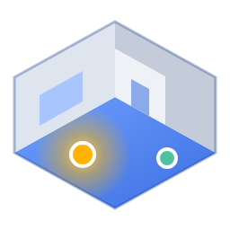
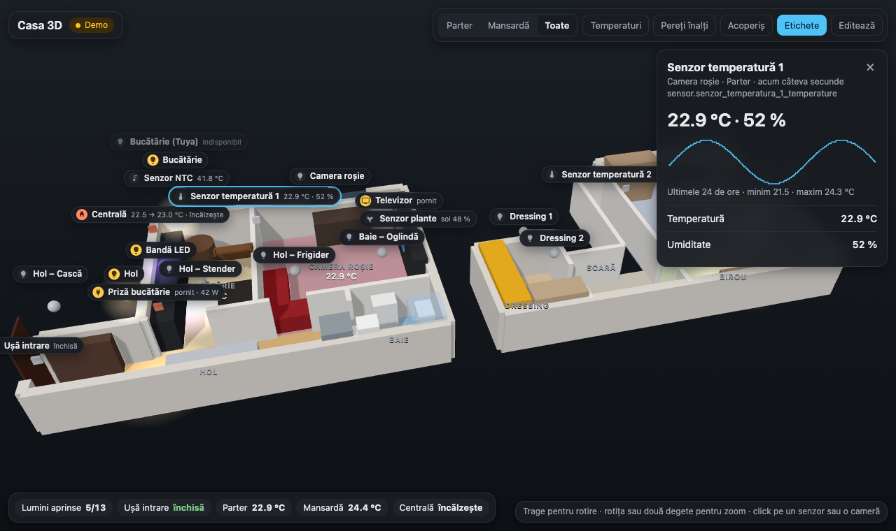
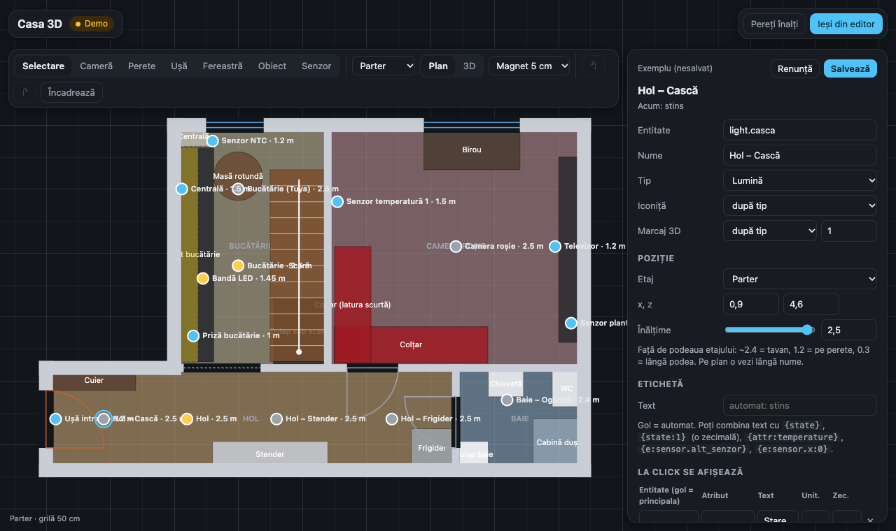
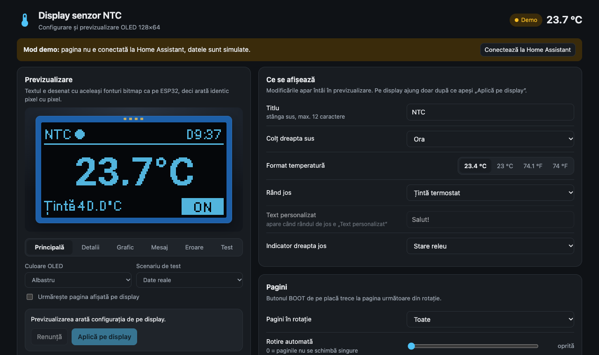

# Casa 3D pentru Home Assistant

Casa ta în 3D, cu luminile, senzorii și restul entităților din Home Assistant puse exact unde sunt în realitate. Schița o desenezi chiar în panou, cu un editor de plan: camere, pereți, uși, ferestre, mobilier și etaje.

*English summary at the end.*

## Ce primești

- **Un panou „Casa 3D” în bara laterală**, cu casa în 3D și senzorii live:
  - luminile strălucesc când sunt aprinse și au culoarea reală;
  - ușile se deschid în model, temperaturile apar pe camere, iar harta de temperaturi e la un click;
  - click pe un dispozitiv: detalii, aprins/stins, luminozitate, termostat, grafic pe 24 h;
  - click pe o cameră: dispozitivele din ea, cu „Aprinde tot” și „Stinge tot”;
  - etaje separate sau toate odată, pereți înalți, acoperiș, etichete.
- **Un editor de plan** (butonul **Editează**), în care desenezi singur casa și pui senzorii pe ea.
- **Merge pe telefon, tabletă și calculator.** Schița se salvează în Home Assistant, așa că o vezi la fel peste tot.
- **Opțional:** un senzor de temperatură NTC pe ESP32, cu display OLED, plus pagina lui de configurare cu previzualizare pixel cu pixel. Vezi [`esphome/`](esphome/README.md).

## Instalare prin HACS

1. În Home Assistant: **HACS → ⋮ (dreapta sus) → Depozite personalizate** (*Custom repositories*).
2. La **Depozit** pune `https://github.com/Dorin-Irimia/ha-casa-3d`, la **Tip** alege **Integrare** (*Integration*), apoi **Adaugă**.
3. Caută **Casa 3D** în HACS și apasă **Descarcă**.
4. **Repornește Home Assistant** (Setări → Sistem → ⏻ → Repornește).
5. **Setări → Dispozitive și servicii → Adaugă integrare → Casa 3D**.

   

6. Panoul **Casa 3D** apare în bara laterală.

Versiunile noi apar în HACS ca actualizări. După o actualizare, repornește HA și reîncarcă pagina.

### Instalare manuală

Copiază folderul [`custom_components/casa_3d`](custom_components/casa_3d) în `/config/custom_components/casa_3d`, repornește HA și continuă de la pasul 5.

## Prima schiță

La prima deschidere, panoul te întreabă cum vrei să începi:

- **Schiță nouă:** un etaj gol. Tragi pe plan ca să desenezi prima cameră.
- **Pornește de la exemplu:** un apartament cu mansardă, pe care îl modifici după casa ta. Din exemplu rămân doar senzorii care există și la tine.
- **Import JSON:** o schiță exportată anterior, de exemplu de pe altă instalare.

Schița o poate **salva doar un administrator**. Ceilalți utilizatori o văd și pot folosi butoanele de pe senzori, dar modificările lor din editor nu se salvează.

## Editorul

- **Plan 2D cu grilă și magnet** de 1, 5 sau 10 cm. Comutatorul **Plan / 3D** îți arată imediat rezultatul.
- **Camere:** desenezi un dreptunghi și îi tragi colțurile. Cerculețele de pe laturi adaugă colțuri noi, deci poți face orice formă. **Pereți pe contur** îi pune pereții automat.
- **Pereți, uși, ferestre:** tragi pereți de la un capăt la altul (cu Shift ies drepți). Ușile și ferestrele le pui cu un click pe perete, apoi le muți și le schimbi lățimea.
- **Obiecte:** pat, canapea, dulap, blat, frigider, duș, WC, scară sau o cutie oarecare. Le muți, le redimensionezi, le rotești și le alegi înălțimea și culoarea.
- **Etaje:** câte vrei, fiecare cu nivelul podelei, înălțimea și, opțional, acoperiș în două ape (mansardă).
- **Senzori:** unealta **Senzor**, un click pe plan, apoi cauți entitatea în lista din HA. Numele, tipul și iconița se completează singure.
  - **Înălțimea** se setează cu un glisor (lângă tavan, pe perete, lângă podea).
  - **Eticheta** poate fi text liber cu valori din HA: `{state}`, `{state:1}` (o zecimală), `{attr:temperature}`, `{e:sensor.alt_senzor}`.
  - **Ce apare la click:** rânduri cu orice entitate sau atribut, grafic pe 24 h, butoane (pornit/oprit, luminozitate, termostat) și butoane proprii care apelează orice acțiune, de exemplu `light.turn_on` cu `{"brightness_pct": 30}`.
  - **Culori după stare:** reguli precum pornit/oprit, egal cu, mai mare, mai mic, între sau indisponibil, fiecare cu culoarea ei și strălucire opțională. Prima regulă potrivită câștigă. O regulă poate verifica și altă entitate.
- **Anulare și refacere** (Ctrl+Z / Ctrl+Shift+Z), duplicare (D), export și import JSON.
- **Scurtături:** V selectare · C cameră · P perete · O obiect · S senzor · Delete șterge · R rotește obiectul cu 90°.

## Setările integrării

**Setări → Dispozitive și servicii → Casa 3D → Configurează**:

| Setare | Ce face |
|---|---|
| Titlul panoului | Numele din bara laterală și din antetul paginii |
| Pictogramă | Pictograma din bara laterală (implicit `mdi:floor-plan`) |
| Panou vizibil doar pentru administratori | Ascunde panoul pentru ceilalți utilizatori |
| Adaugă și configuratorul display-ului NTC | Panoul **Display NTC**, doar dacă ai construit și [senzorul NTC](esphome/README.md) |

## Unde se păstrează schița

- În `/config/.storage/casa_3d.config`, deci intră în backup-urile Home Assistant.
- Dacă ștergi integrarea, schița rămâne acolo pentru o eventuală reinstalare.
- Pentru o copie separată sau ca să o muți pe altă instalare, folosește **Export JSON** din editor.

## Fără integrare

Pagina merge și singură. Copiază folderul [`custom_components/casa_3d/frontend/apartament`](custom_components/casa_3d/frontend/apartament) în `/config/www/apartament/`, apoi **Setări → Panouri de control → Adaugă panou → Pagină web**, cu URL-ul `/local/apartament/index.html?v=1`.

În acest mod, schița se salvează într-un panou de control ascuns, `apartament-3d-date`. Dacă instalezi mai târziu integrarea, schița e preluată automat la prima deschidere a panoului Casa 3D.

## Senzorul NTC cu display (opțional)

În [`esphome/`](esphome/README.md) găsești firmware-ul ESPHome pentru un termometru cu sondă NTC de 10 kΩ pe ESP32:

- display OLED 128×64 configurabil din HA;
- termostat cu releu, alarme și detecția senzorului defect;
- schema de conectare, calibrarea și cardul pentru dashboard.

Pagina lui de configurare vine cu integrarea: bifează **„Adaugă și configuratorul display-ului NTC”** în setări.

## Probleme frecvente

- **Panoul nu apare după instalare:** repornește Home Assistant, apoi reîncarcă pagina din browser (sau închide și redeschide aplicația).
- **„Nu am putut salva”:** contul tău nu e administrator. Folosește **Export JSON** și roagă un administrator să importe schița.
- **Un senzor apare „lipsă din HA”:** entitatea a fost redenumită sau ștearsă. Selectează senzorul în editor și alege entitatea nouă.

## Structura depozitului

| Cale | Ce conține |
|---|---|
| `custom_components/casa_3d/` | Integrarea instalată de HACS |
| `custom_components/casa_3d/frontend/apartament/` | Pagina 3D (`index.html`) și Three.js r160 (local, fără CDN) |
| `custom_components/casa_3d/frontend/ntc-display.html` | Configuratorul display-ului NTC |
| `esphome/` | Firmware-ul senzorului NTC și documentația lui |
| `home-assistant/` | Card de dashboard și automatizare de alarme pentru senzorul NTC |
| `tools/genereaza-fonturi.py` | Regenerează fonturile previzualizării OLED |

## English

**Casa 3D** adds a sidebar panel that shows your home in 3D with your Home Assistant entities placed in it: lights that glow in their real colour, doors that open, room temperatures, and a details panel with controls and a 24 h graph. A built-in floor-plan editor lets you draw rooms, walls, doors, windows, furniture and floors, place any entity at any height, customise its label and click panel, and colour it by state rules. The plan is stored in Home Assistant (`.storage/casa_3d.config`), so it looks the same on every device. Only administrators can save it.

Install it through HACS as a custom repository (category *Integration*), restart Home Assistant, then add the **Casa 3D** integration. The interface is in Romanian.

## Licență

[MIT](LICENSE). Three.js este inclus sub licența MIT (© Three.js Authors).
